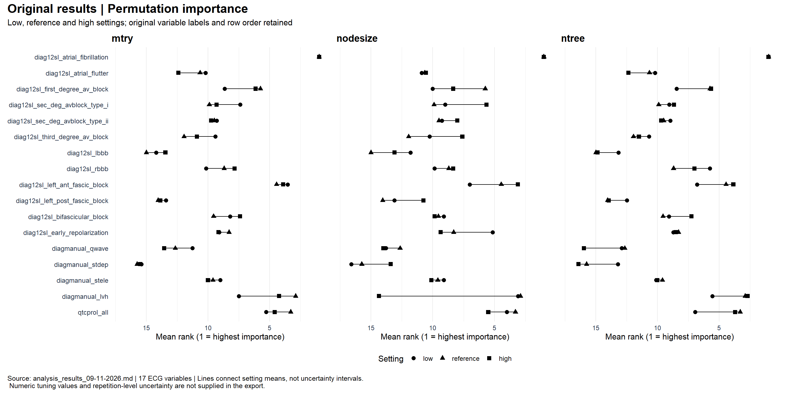
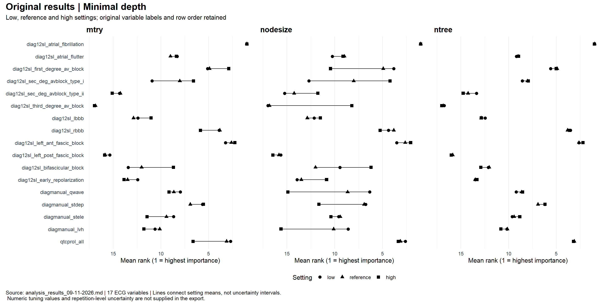
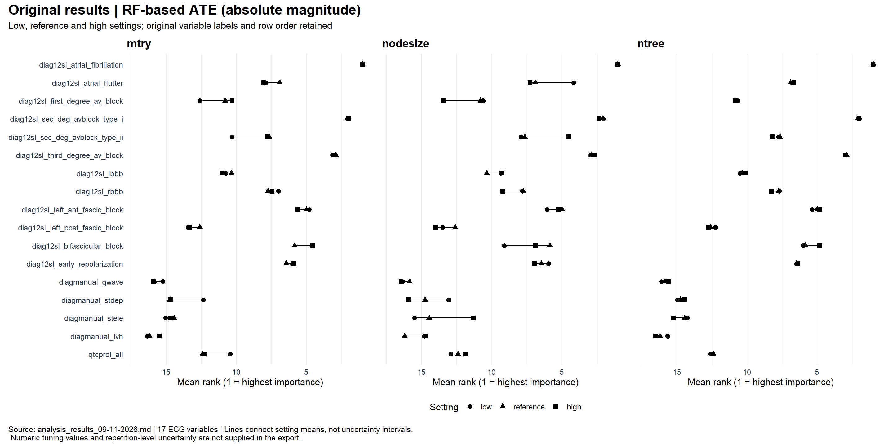
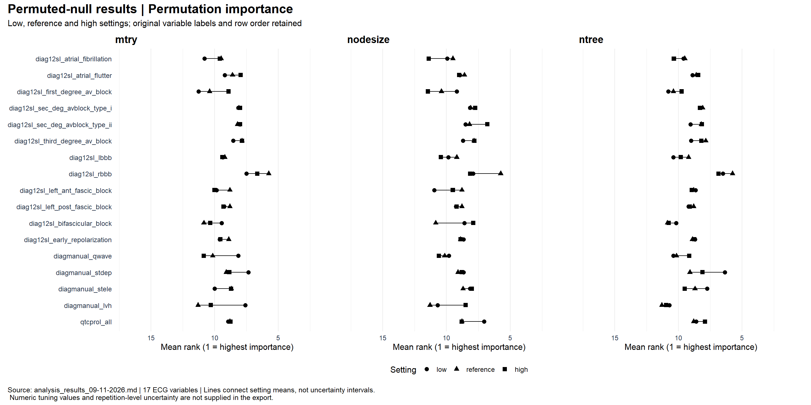
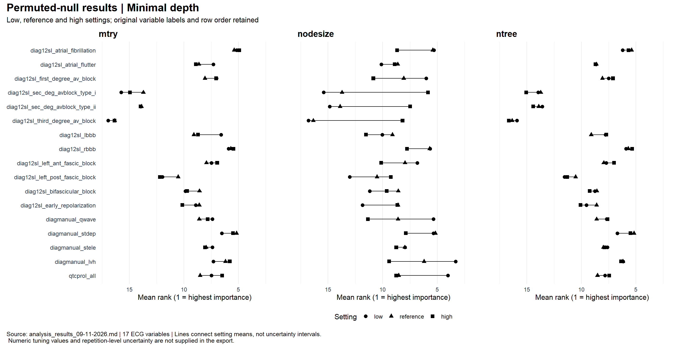
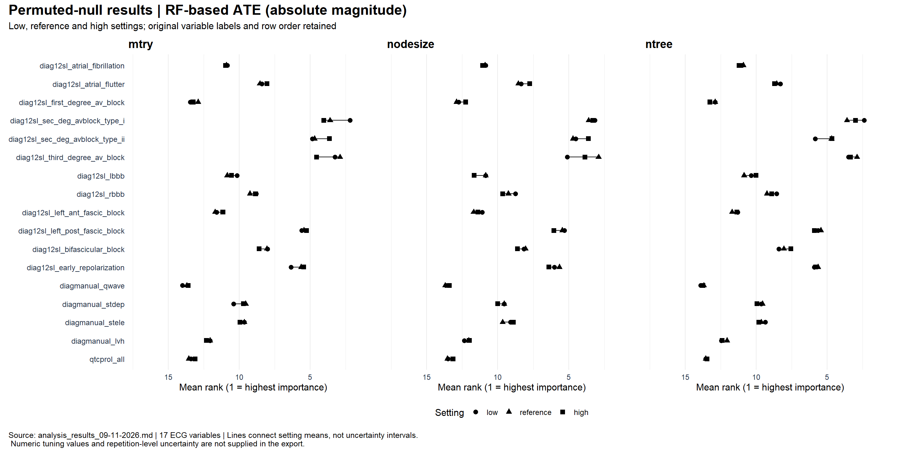

# RF-VIMP report 3
# 1: Predictive information contained in ECG variables
## Method
To investigate the amount of predictive information contained in the ECG variables, we compare the predictive performance of a random forest that uses only ECG variables to the null model, using the Index of Prediction Performance(IPA).
To model is trained on half of the data sample, and prediction preformance is evaluated on the other half.
We do the same for a cause-specific Cox model.
The target of prediction is out of hospital cardiac arrest within 5 years of first ECG measurement.
The data sample for the IPA calculation is a subset of the full ECG+OHCA dataset.
It contains all patients who had an event during the study, and 1% of the patients who did not have an event during the study, sampled uniformly at random.
The sample data contained about 20000 patients who had an event and about 20000 without.
The hyperparameters of the random forest is mtry = 16, nodesize = 20 and mtree = 50.
## Result
The IPA for each model can be seen below.

| Model | IPA |
|---|---:|
| Random forest (binary outcome) | 0.1017 |
| Cause-specific Cox model (CSC) | 0.0401 |

Source: [results exported 9 November 2026](analysis_results_09-11-2026.md).

## Discussion
The computation conducted here compares a model using only ECG variables to a null model.
Perhaps it would be interesting to compare a model using only demographic, comorbidity and medication variables (background variables) to a model that uses ECG variables in addition to these.
Since the background variables are usually know, both in clinical and epidemiological settings (at least in Denmark), it seems relevant to know how much predictive performance increases *in excess* of the performance achieved by a model using background variables.

# 2: Effect of hyperparameters on importance rankings
## Investigating IPA for data generating mechanism
In order to investigate performance for variable importance in a realistic setting, we wish to match the predictive power of the variables of interest in our data generating process to that of the desired application.
### Method
We will measure predictive performance using IPA.
The target IPA for our data generating mechanism is that of the CSC model on the data sample: 0.0401.
For a grid of effect sizes, we simulate a dataset of similar size to the data sample(40000) from a logistic regression model and compute the IPA of a random forest on it.
In the simulation model, the baseline risk is 0.5 and only one of the ECG variables have an effect.
The hyperparameters of the random forest is mtry = 17, nodesize = 20 and mtree = 100.
### Results
The resulting IPA values can be seen below. The effect sizes are specified at the log odds ratio scale.

| Effect size (log odds ratio) | IPA |
|---:|---:|
| 2 | 0.02080484 |
| 3 | 0.02877325 |
| 4 | 0.03254084 |
| 5 | 0.03670162 |
| 6 | 0.03639141 |

Source: [results exported 9 November 2026](analysis_results_09-11-2026.md); effect sizes are the natural logarithms of the exported odds ratios, rounded to integers.

### Discussion
Upon making the calculation, I was surprised to find that very large effect sizes were needed to achieve an IPA similar to that of the CSC model on the sample data.
I have since realized that the IPA for a model with a single binary covariate is bounded by a combination of the baseline risk and the prevalence of the covariate.

## Effect of hyperparameters on importance rankings: Single covariate with effect, covariance of ECG variables preserved
### Method
To investigate the effect of hyperparameter choice on importance rankings, we computed average importance rank of each ECG variable for a reference setting of hyperparameters on data simulated according to the scheme described in the section above.
For each hyperparameter under investigation, we computed average importance rank of each ECG variable when the hyperparameter was set to lower and higher values respectively than the reference value, with the other hyperparameters at the reference values.
These computations were performed for permutation importance, minimal depth and ATE.
The hyperparameters used for the random forests are shown in the table bewlow.

|          | low | reference | high |
|----------|----:|----------:|-----:|
| mtry     | 3   | 8         | 42   |
| nodesize | 5   | 50        | 2000 |
| ntree    | 25  | 50        | 200  |

The log-odds-ratio used for gerating data was 9.
### Results
Below, the effect of changing a hyperparameter from the reference value to a higher/lower value is illustrated by importance measure and hyperparemeter.

### Discussion
That each variable importance measure consistently identifies the one variable which has an effect is not that surprising, considering the extremely large effect size used in the simulation scheme.
I think it would be interesting to run the same analysis using a more modest effect size.

## Effect of hyperparameters on importance rankings: Single covariate with effect, ECG variables of null effect permueted
In the previous version of the analysis, it appeared that some variables of null effect were consistently ranked lower than other variables of null effect.
It was suggested that this was a consequence of different correlation between the variable with effect and each of the null-effect variables.
### Method
To break the correlation between the null-effect variables and the variable with effect, we randomly permuted vector of null-effect variables between each patient and re-ran the variable importance calculation described in the previous section.
### Results
Below, the effect of changing a hyperparameter from the reference value to a higher/lower value is illustrated by importance measure and hyperparemeter.

### Discussion
It is unclear to me what we can infer from the results above.
It is somewhat surprising that the average ranking of the variable with an effect drops to an average rank of about 10 for permuataion importance and ATE and 5 for minimal depth. It is unclear to me why permuting the null-effect variables makes it harder to find the important variable.
It appears that choosing a large node size draws the average rank of every variable towards the mean rank of 9, making it less likely to identify the important variable but also less likely to mistakenly label a null-effect variable as important.

# Suggested improvements/next steps
## 1. Less extreme effect size
Rerun the analysis of the effect of hyperparameters on importance rankings, but for a different combintation of baseline risk and effect size, to get a similar IPA to the CSC model on real data, but with a less extreme effect size.

## 2. Investigate improvement in predictive performance when ECG variablse are added to background variables
Supplement the current IPA scores on real data with a comparison of models using only background variables to models using ECG variables in addition to background variables.

## 3. Invetigate if prevalence alone effects variable importance in the absence of causal effects
If we simulate a number of covariates with a range of different prevalences that are all mutually independent and have no effect on the outcome, are the more prevalent variables ranked higher/lower?